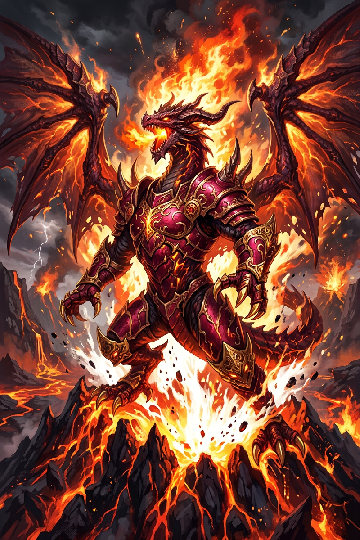
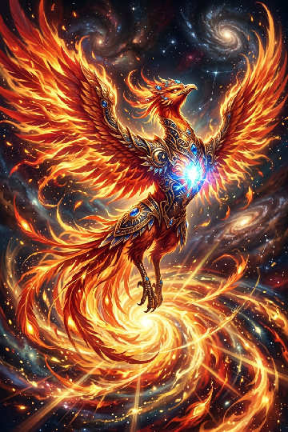
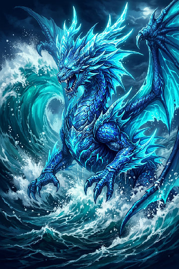
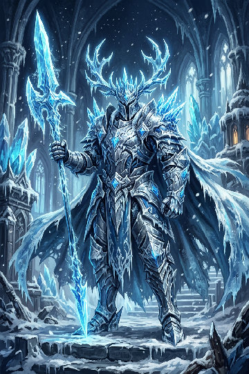
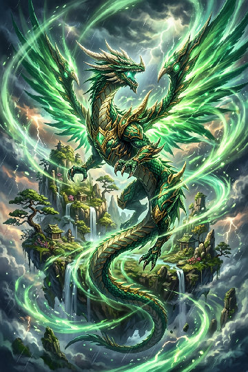
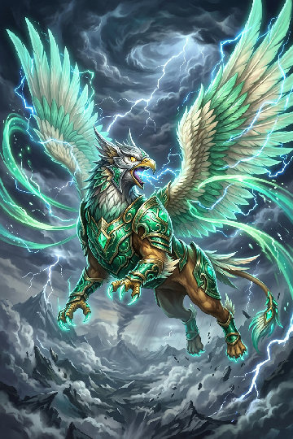
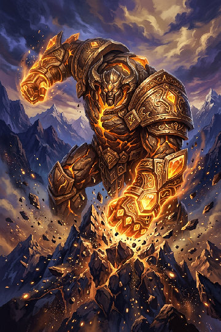
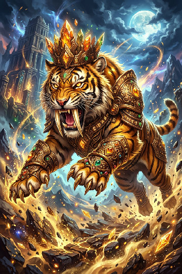
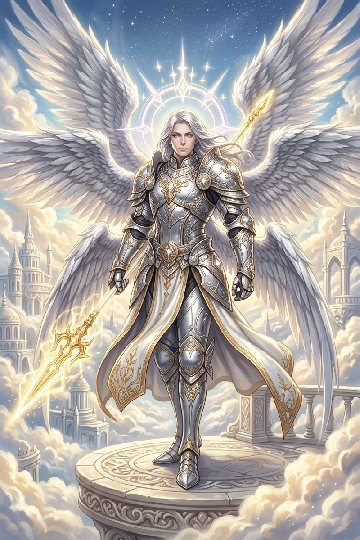
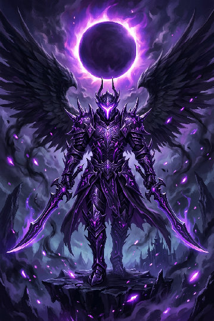

# 伝説のカード10枚 — RE:FRAME 強力カードパック

**保存が難しかった方向け：ゲーム内「伝説のカード図鑑」から直接カードを作れます。** ホームの竜のカードをタップ、または「カード作成 → ★ 伝説のカード図鑑」を開き、好きなカードの「この画像でカードを作る」を押してください。その後「チームに追加」で編成します。既存の編成を勝手に置き換えることはありません。

## GitHubから保存する

### いちばん簡単：10枚まとめて

**[⬇ 原本PNG10枚をZIPでまとめて保存](strong-cards-10.zip?raw=true)**（約40MB）

1. 上のリンクを開いてZIPをダウンロード。ダウンロードされなければGitHubのファイル画面で「Download raw file」（下向き矢印）を押します。
2. iPhoneは「ファイル」、Androidはファイル管理アプリなどでZIPを展開します。
3. ゲームで「カード作成 → 写真を選ぶ」。展開した `originals` 内のPNGを選びます。
4. カード名は下の一覧を参考に変更し、「チームに追加」を押します。3枚そろえると対戦できます。

### 1枚ずつ保存

各カードの「原本PNGを保存」を押します。画像が開いたら保存、またはGitHubの画像ファイル画面で「Download raw file」を押してください。**スクリーンショットではなくPNGファイルそのもの**を使います。

## 大切な注意

- 対応ルールは **photo-v3**。10枚とも別々のレア技を1つずつ持ち、全6属性を網羅しています。
- 読み込み用は `originals/*.png`。ギャラリーの小さいJPEGやゲームが書き出す「記念用カード画像」を再読み込みすると、能力が変わります。
- LINE等での画像送信、JPEG変換、縮小、編集、スクリーンショットは避けてください。転送するならZIPまたはファイル添付が確実です。
- キラ加工だけは生成ごとに抽選。同じPNGからの属性・レベル・能力・技は変わりません。
- 4,000×6,000px・各約3.5〜3.8MiB。ゲームの12MiB／2,400万画素制限以内ですが、低メモリ端末では解析が重い場合があります。図鑑では選んだ1枚だけを取得して解析します。
- 「最強」は保証しません。高い能力と強力なレア技を狙って選んだ候補集です。相性、状態異常、PP、先制、交代で勝敗は変わります。レア技は2〜3PP、反動や命中90%の技にも注意してください。
- このパックは公開GitHub向けのオリジナルAI生成イラストです。ユーザーの私的な写真は含めていません。

## 10枚のラインナップ

|カード|属性|レア技|HP|物攻|特攻|素早さ|
|---|---|---|---:|---:|---:|---:|
|[焔帝竜ヴァルカノス](#01-flame-dragon)|炎|灼天の王冠|313|212|249|231|
|[不死鳥フェニクシア](#02-phoenix)|炎|不死鳥の双牙|299|229|248|231|
|[海神竜リヴァイア](#03-ocean-leviathan)|水|海神の三叉流|291|204|244|231|
|[氷皇騎士グラシオン](#04-frost-knight)|水|絶零の大潮|269|212|247|231|
|[翠嵐竜エメラルディア](#05-jade-dragon)|風|天穹断裂|283|243|248|231|
|[神翼獣ゼファリオン](#06-storm-griffin)|風|神速の双翼|316|220|249|231|
|[大地神タイタノヴァ](#07-titan)|地|星砕き|320|227|249|231|
|[金牙王ガイアファング](#08-quake-tiger)|地|大陸崩壊|296|247|248|231|
|[創世天セラフィエル](#09-light-seraph)|光|創世の光槍|348|123|178|231|
|[冥翼王ノクスレイヴ](#10-shadow-reaper)|闇|冥王の双刃|205|220|249|231|

### 焔帝竜ヴァルカノス

**炎属性 / Lv.11 — 灼熱の特殊アタッカー**

[⬇ 原本PNGを保存](originals/01-flame-dragon.png?raw=true) · 3.60MiB

HP **313** / 物理攻撃 **212** / 物理防御 **190** / 特殊攻撃 **249** / 特殊防御 **216** / 素早さ **231** / 急所 **77** / 状態異常耐性 **61** / 回復力 **69** / 貫通力 **85**

|技|威力|命中|PP|効果|
|---|---:|---:|---:|---|
|双炎牙|30×2|100%|12|2回連続で攻撃する。PPは1回分だけ消費。|
|生命の光輪|55|100%|10|与えたダメージの60%を基準にHP吸収。回復力で増減。|
|晶石の休息|—|100%|5|通常回復量の75%を回復し、特殊防御を1段階上げる。|
|★ 灼天の王冠|160|100%|3|威力160。攻撃後65%を基準にやけど。相手の耐性で軽減。|

原本の照合情報

SHA-256: `e623a994a5287b3badbba8d6e0c4fa528a2698ddd8ce8f1af11fd6327d9a1d2a`

探索シード: 11410 / photo-v3。全特徴値と技定義は [manifest.json](manifest.json)。

### 不死鳥フェニクシア

**炎属性 / Lv.11 — 炎の連撃アタッカー**

[⬇ 原本PNGを保存](originals/02-phoenix.png?raw=true) · 3.68MiB

HP **299** / 物理攻撃 **229** / 物理防御 **196** / 特殊攻撃 **248** / 特殊防御 **210** / 素早さ **231** / 急所 **88** / 状態異常耐性 **61** / 回復力 **68** / 貫通力 **92**

|技|威力|命中|PP|効果|
|---|---:|---:|---:|---|
|灰燼砕き|55|100%|10|攻撃後、相手の物理防御を1段階下げる。|
|夜喰らい|65|100%|8|与えたダメージの45%を基準にHP吸収。回復力で増減。|
|灼熱の闘志|—|100%|7|自分の物理攻撃を2段階上げる。|
|★ 不死鳥の双牙|75×2|100%|3|威力75の2連撃。与えた実ダメージの15%を反動で受ける。|

原本の照合情報

SHA-256: `a6260e14542a9e8693c05c47cde2de504cb205275e376e63900f9e369693147f`

探索シード: 13662 / photo-v3。全特徴値と技定義は [manifest.json](manifest.json)。

### 海神竜リヴァイア

**水属性 / Lv.11 — 三連撃と吸収の海王**

[⬇ 原本PNGを保存](originals/03-ocean-leviathan.png?raw=true) · 3.67MiB

HP **291** / 物理攻撃 **204** / 物理防御 **199** / 特殊攻撃 **244** / 特殊防御 **207** / 素早さ **231** / 急所 **77** / 状態異常耐性 **63** / 回復力 **69** / 貫通力 **85**

|技|威力|命中|PP|効果|
|---|---:|---:|---:|---|
|水命吸収|60|100%|10|与えたダメージの45%を基準にHP吸収。回復力で増減。|
|夜喰らい|65|100%|8|与えたダメージの45%を基準にHP吸収。回復力で増減。|
|浄化の雨|—|100%|5|自分の状態異常を治し、通常回復量の65%を回復する。|
|★ 海神の三叉流|50×3|100%|3|威力50の3連撃。実ダメージの40%を基準に吸収。回復力で増減。|

原本の照合情報

SHA-256: `30f2702bb9893bee4a57cea10395ec442f678d49cdf3cc634e6ba6d0e326731b`

探索シード: 8079 / photo-v3。全特徴値と技定義は [manifest.json](manifest.json)。

### 氷皇騎士グラシオン

**水属性 / Lv.11 — 鈍足で流れを変える騎士**

[⬇ 原本PNGを保存](originals/04-frost-knight.png?raw=true) · 3.75MiB

HP **269** / 物理攻撃 **212** / 物理防御 **208** / 特殊攻撃 **247** / 特殊防御 **198** / 素早さ **231** / 急所 **79** / 状態異常耐性 **61** / 回復力 **63** / 貫通力 **86**

|技|威力|命中|PP|効果|
|---|---:|---:|---:|---|
|水命吸収|60|100%|10|与えたダメージの45%を基準にHP吸収。回復力で増減。|
|疾風の先駆け|38|100%|14|通常の技より先に攻撃する。先制技同士は素早さ順。|
|生命のしずく|—|100%|5|自分のHPを回復。回復力が高いほど効果アップ。|
|★ 絶零の大潮|110|100%|3|攻撃後、鈍足を狙う。基本成功率100%、相手の耐性で軽減。|

原本の照合情報

SHA-256: `1b1e09191e82a0967b5e85e8d597fcd93058fa7338833bb3d6fd65b1ee00b3a7`

探索シード: 2457 / photo-v3。全特徴値と技定義は [manifest.json](manifest.json)。

### 翠嵐竜エメラルディア

**風属性 / Lv.11 — 防御を貫く特殊アタッカー**

[⬇ 原本PNGを保存](originals/05-jade-dragon.png?raw=true) · 3.72MiB

HP **283** / 物理攻撃 **243** / 物理防御 **202** / 特殊攻撃 **248** / 特殊防御 **204** / 素早さ **231** / 急所 **97** / 状態異常耐性 **61** / 回復力 **77** / 貫通力 **98**

|技|威力|命中|PP|効果|
|---|---:|---:|---:|---|
|疾風の先駆け|38|100%|14|通常の技より先に攻撃する。先制技同士は素早さ順。|
|真空裂き|65|100%|9|技の効果で相手の有効な防御をさらに40%無視する。|
|浄化の雨|—|100%|5|自分の状態異常を治し、通常回復量の65%を回復する。|
|★ 天穹断裂|125|100%|3|威力125。相手の有効防御をさらに60%無視する。|

原本の照合情報

SHA-256: `c91f32d168ec5ad154f0e190179fb177fc97fa3f03d402354dd2295f3e575038`

探索シード: 619 / photo-v3。全特徴値と技定義は [manifest.json](manifest.json)。

### 神翼獣ゼファリオン

**風属性 / Lv.11 — 先制二連撃の空の王**

[⬇ 原本PNGを保存](originals/06-storm-griffin.png?raw=true) · 3.61MiB

HP **316** / 物理攻撃 **220** / 物理防御 **189** / 特殊攻撃 **249** / 特殊防御 **217** / 素早さ **231** / 急所 **82** / 状態異常耐性 **61** / 回復力 **82** / 貫通力 **88**

|技|威力|命中|PP|効果|
|---|---:|---:|---:|---|
|疾風の先駆け|38|100%|14|通常の技より先に攻撃する。先制技同士は素早さ順。|
|生命の光輪|55|100%|10|与えたダメージの60%を基準にHP吸収。回復力で増減。|
|浄化の雨|—|100%|5|自分の状態異常を治し、通常回復量の65%を回復する。|
|★ 神速の双翼|55×2|100%|3|通常技より先に、威力55の2連撃。先制技同士は素早さ順。|

原本の照合情報

SHA-256: `805c5661b29fb2cfa3f9d07ea363985057c579ab712f48860cfc793807f8bafd`

探索シード: 3220 / photo-v3。全特徴値と技定義は [manifest.json](manifest.json)。

### 大地神タイタノヴァ

**地属性 / Lv.11 — 威力180の一撃型**

[⬇ 原本PNGを保存](originals/07-titan.png?raw=true) · 3.58MiB

HP **320** / 物理攻撃 **227** / 物理防御 **187** / 特殊攻撃 **249** / 特殊防御 **219** / 素早さ **231** / 急所 **86** / 状態異常耐性 **61** / 回復力 **78** / 貫通力 **91**

|技|威力|命中|PP|効果|
|---|---:|---:|---:|---|
|断層貫き|70|100%|8|技の効果で相手の有効な防御をさらに40%無視する。|
|水命吸収|60|100%|10|与えたダメージの45%を基準にHP吸収。回復力で増減。|
|生命のしずく|—|100%|5|自分のHPを回復。回復力が高いほど効果アップ。|
|★ 星砕き|180|90%|2|威力180の超重撃。命中90%。|

原本の照合情報

SHA-256: `ecb9047d49e4385c658e62f9fb14b2637ce49945718f49dca91269624de8b973`

探索シード: 7827 / photo-v3。全特徴値と技定義は [manifest.json](manifest.json)。

### 金牙王ガイアファング

**地属性 / Lv.11 — 物理防御を砕く猛獣**

[⬇ 原本PNGを保存](originals/08-quake-tiger.png?raw=true) · 3.74MiB

HP **296** / 物理攻撃 **247** / 物理防御 **197** / 特殊攻撃 **248** / 特殊防御 **209** / 素早さ **231** / 急所 **100** / 状態異常耐性 **61** / 回復力 **73** / 貫通力 **100**

|技|威力|命中|PP|効果|
|---|---:|---:|---:|---|
|断層貫き|70|100%|8|技の効果で相手の有効な防御をさらに40%無視する。|
|夜喰らい|65|100%|8|与えたダメージの45%を基準にHP吸収。回復力で増減。|
|生命のしずく|—|100%|5|自分のHPを回復。回復力が高いほど効果アップ。|
|★ 大陸崩壊|120|100%|3|攻撃後、相手の物理防御を2段階下げる。|

原本の照合情報

SHA-256: `c605132be8a95f036fa640deec0d135a9de308492374e20534c4390eda60a2b0`

探索シード: 8828 / photo-v3。全特徴値と技定義は [manifest.json](manifest.json)。

### 創世天セラフィエル

**光属性 / Lv.11 — 高HPと貫通光槍の守護者**

[⬇ 原本PNGを保存](originals/09-light-seraph.png?raw=true) · 3.62MiB

HP **348** / 物理攻撃 **123** / 物理防御 **176** / 特殊攻撃 **178** / 特殊防御 **230** / 素早さ **231** / 急所 **89** / 状態異常耐性 **91** / 回復力 **65** / 貫通力 **92**

|技|威力|命中|PP|効果|
|---|---:|---:|---:|---|
|生命の光輪|55|100%|10|与えたダメージの60%を基準にHP吸収。回復力で増減。|
|疾風の先駆け|38|100%|14|通常の技より先に攻撃する。先制技同士は素早さ順。|
|魔力瞑想|—|100%|7|自分の特殊攻撃を2段階上げる。|
|★ 創世の光槍|130|100%|3|威力130。相手の有効防御をさらに50%無視する。|

原本の照合情報

SHA-256: `2a925cc4d1a3d68d4876c994595812b6f877795f701f87b9e329195424528cae`

探索シード: 12276 / photo-v3。全特徴値と技定義は [manifest.json](manifest.json)。

### 冥翼王ノクスレイヴ

**闇属性 / Lv.11 — 先制二連撃の冥王**

[⬇ 原本PNGを保存](originals/10-shadow-reaper.png?raw=true) · 3.53MiB

HP **205** / 物理攻撃 **220** / 物理防御 **233** / 特殊攻撃 **249** / 特殊防御 **173** / 素早さ **231** / 急所 **82** / 状態異常耐性 **61** / 回復力 **58** / 貫通力 **88**

|技|威力|命中|PP|効果|
|---|---:|---:|---:|---|
|影の奇襲|38|100%|14|通常の技より先に攻撃する。先制技同士は素早さ順。|
|生命の光輪|55|100%|10|与えたダメージの60%を基準にHP吸収。回復力で増減。|
|解呪の息吹|—|100%|5|状態異常を治し、通常回復量の50%を回復する。|
|★ 冥王の双刃|70×2|100%|2|先制で威力70の2連撃。実ダメージの20%を反動で受ける。|

原本の照合情報

SHA-256: `3e062a843a32d0c6189aa5c7e7294c650732f97e837865bed15c6a89c255682b`

探索シード: 3043 / photo-v3。全特徴値と技定義は [manifest.json](manifest.json)。

## 作り方と検証

- 各属性14,000パターン、合計84,000パターンの64×64色配置を探索。高い能力と技の組み合わせを重み付け採点し、10種類の指定レア技ごとに候補を選びました。全組み合わせの厳密な最適解ではありません。
- 画像はAI生成したイラストをベースに、解析の標本点4,096px（全2,400万画素の約0.017%）の色を調整しています。見た目の絵だけではなく、この微細な加工が強さに寄与します。縮小等で加工が失われると同じ能力は再現されません。ゲーム本体の能力式やレア抽選は変更していません。
- 最終PNGをゲーム本体の `decodeImage → sampleImage → analyzePixels → generateCharacter` で再解析し、属性・10能力・レベル・4技・ハッシュの一致を10枚すべて検証。
- [生成スクリプト](../../scripts/build-strong-cards.mjs) ／ [回帰テスト](../../tests/vault.test.js)。
- `previews/` は閲覧専用の軽量JPEG。`manifest.json` は原本ハッシュ、寸法、サイズ、特徴値、能力、技の検証用データです。
